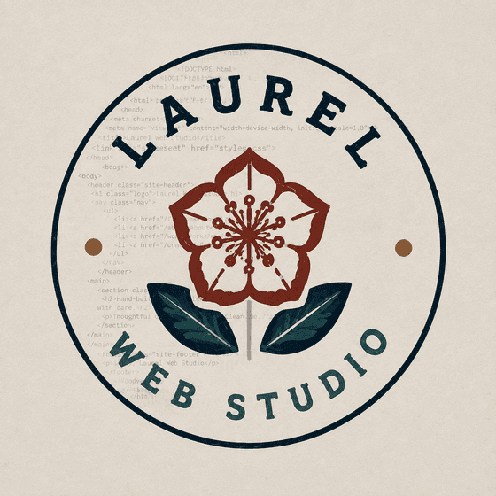

  

<h1 align="center">Laurel Web Studio</h1>

  Websites that get you booked. Web design for small businesses in western PA and northern WV.

  
  
  

## About

A small studio in Westmoreland County. We audited 165 local business websites across five
counties, on a phone, the way a customer would; only 42 passed clean. We build the fix: fast
static sites at a fixed price, measured on every change, with one point of contact from the
first call to launch.

## Tools and languages

  

## Featured work

| Project | What it does |
|---|---|
| [laurelwebstudio.com](https://laurelwebstudio.com) | The studio site: book a free audit, fixed-price builds from $1,000. |
| [What I can build](https://laurelwebstudio.com/what-i-can-build/) | Working demos, not screenshots: instant menu filtering, hours that answer the question, a ballpark quote and a commission-free deposit. |
| [The fancy stuff](https://laurelwebstudio.com/the-fancy-stuff/) | The showroom: a press-roller arrival, a card printed plate by plate, and the rest of the motion work, all built here. |
| [Sample report card](https://laurelwebstudio.com/sample-report/) | A complete sample of the free written audit: eight plain-English grades, Google listing first. |

Client work lives in private repositories. Reach us at
[info@laurelwebstudio.com](mailto:info@laurelwebstudio.com) or (724) 201-9103.
